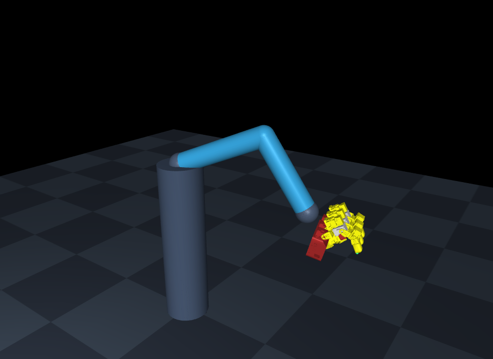

# QuadraDex-Software

Software for the QuadraDex dexterous hand teleoperation robotics capstone.

The software includes a close-up hand-tracking prototype and an experimental full-arm + hand teleoperation simulator. The latter tracks shoulder, elbow, wrist and fingers, generates bounded joint targets, and visualizes a configurable seven-joint arm carrying the official LEAP Hand V1 model.



## Run the full-arm and LEAP simulator

On 64-bit Windows with Python 3.11 installed, open PowerShell in this repository:

```powershell
.\run_teleop.bat
```

Select a camera, keep both shoulders/hips and the selected arm/fingers visible, capture the open/neutral pose with **O**, capture the closed pose with **C**, then press **Space** to start the simulated target stream. The calibration display shows progress and pause/retry guidance. The separate 3D window supports orbit/zoom and **F** for a close hand view.

To try generated arm/finger motion without a camera:

```powershell
.\run_teleop.bat --demo
```

See the [full-arm/simulation guide](teleoperation/README.md) for camera framing, output signals, model configuration, accuracy evaluation and validation limits. The physical LEAP revision is unconfirmed, so V1 signals are labeled and applied to simulation; no motor bus is opened. Physical arm accuracy remains to be established using the included independent-reference evaluator.

## Run the hand-tracking prototype

On 64-bit Windows with Python 3.11 installed, open PowerShell in this repository and run:

```powershell
.\cv_hand_tracking\run_tracker.bat
```

The launcher installs the required libraries into an isolated local environment and downloads the model on first use. Select a camera by name, confirm its live preview, and choose **Use camera**.

- Press **O** to capture the open pose, then **C** to capture the closed pose. The display shows preparation, progress, sample counts, pause reasons, and completion.
- Press **Space** to start or stop the target stream; **S** stops it.
- Press **V** to choose another camera, **H** to change the hand selection, or **M** to reverse the camera's hand labels.
- Press **Q** or **Esc** to quit.

See the [hand-tracking guide](cv_hand_tracking/README.md) for setup, camera options, output format, UDP integration, timing measurements, and limitations.

## Repository layout

- [`cv_hand_tracking/`](cv_hand_tracking/): tracker, camera picker, guided calibration, geometry, example receiver, and tests.
- [`teleoperation/`](teleoperation/): synchronized arm/hand sensing, constrained IK, LEAP V1 signals, simulation, configurable demo arm, reference evaluator and tests.
- [`docs/QuadraDex_spec_v1.1.pdf`](docs/QuadraDex_spec_v1.1.pdf): project requirements.
- [Concept design](<docs/Concept_Design_Quadradex (1).pdf>): architecture and subsystem interfaces.

## Verification

After the launcher has installed the dependencies:

```powershell
.\cv_hand_tracking\.venv\Scripts\python.exe -m unittest discover -s cv_hand_tracking -v
.\cv_hand_tracking\.venv\Scripts\python.exe -m unittest teleoperation.test_teleoperation -v
```

The suites contain 17 hand-only and 14 arm/control/simulation checks. Real-model and synthetic application integration checks exercised loss/recovery, packet delivery, camera switching, guided paired calibration and simulated command execution. The guides distinguish these from physical-hand/arm and hardware validation.

## Integration status

The full-arm prototype generates paired robot joint signals and drives the simulation from those same packets. The physical arm/model is not yet selected; the demo topology is configurable. Physical hardware communication, measured limits, tracking/retargeting accuracy validation, and the independent stop path remain integration work. Single-camera depth and occluded-finger estimates require experimental validation.

Camera logs, personal calibration profiles, virtual environments, downloaded models, and generated sample previews are excluded from version control.
